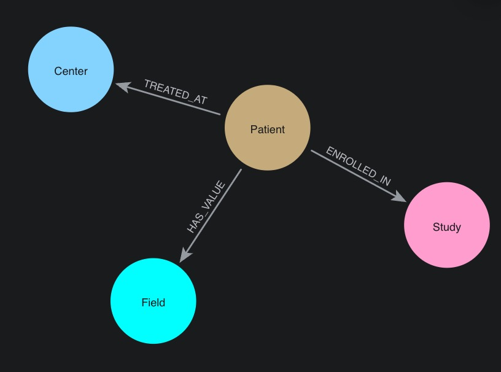

# Open Data for Predicting Non-Relapse Mortality after Allogeneic Transplant

Research notes, analysis outputs and tools for finding **openly available patient-level data** to model **non-relapse mortality (NRM)**, also called treatment- or transplant-related mortality (TRM), after allogeneic hematopoietic cell transplant (HCT) for leukemia.

## Summary

**The question.** Two well-known machine-learning studies predict mortality after allogeneic HCT from information available before transplant: Shouval et al., *J Clin Oncol* 2015 (Day +100 mortality, ~28,000 acute leukemia patients), and Mussetti et al., *Bone Marrow Transplant* 2024 (overall mortality and NRM, 33,927 patients). Can we get their data and run our own analysis?

**The answer: not their data, but there is a usable alternative.**

- **The EBMT registry data behind both papers is not public.** Access needs a formal request to EBMT, normally through a member centre or working party.
- **CIBMTR,** the main US transplant registry, publishes the analysis dataset from **160** of its studies as a free download, subject to its terms of use.
- **We screened all 160.** We downloaded and parsed every data dictionary (6,976 variables), downloaded every dataset (about 120 MB, 815,000 patient rows in total), and ranked each study on how well it supports an NRM model for leukemia/MDS:
  - **31 core candidates (tier A):** allogeneic HCT for leukemia/MDS with an NRM/TRM outcome and the standard pre-transplant predictors. Together they hold 58,622 patients, with crude TRM proportions of 13–31%.
  - **48 supplementary datasets (tier B):** mixed-disease allogeneic groups that include leukemia/MDS and carry NRM. Together they hold about 243,000 patients.
- **Best starting points:**
  - The largest leukemia/MDS files: **P-5646** (7,551 patients), **P-5329** (5,508), **P-5702** (4,946), **P-5370** (4,387), **P-5521** (4,037) and **P-5435** (3,677).
  - The richest predictor sets, though small: **P-6238** and **P-5411**.
  - The closest to a published prediction model: **P-5300** (MDS, Nazha).
- **Main caveats:**
  - Each file is one paper's analysis set, so no single file matches the EBMT scale.
  - Some studies share the same patients.
  - CIBMTR's terms forbid redistributing the data and may restrict combining files.

The full write-up is in [`research/`](research/README.md).

## Table of contents

### Research

| | |
|---|---|
| [Research index](research/README.md) | Overview of the write-ups |
| [1. The question and EBMT data access](research/01-question-and-ebmt-data-access.md) | The two EBMT papers and how (not) to get their data |
| [2. The CIBMTR public datasets](research/02-cibmtr-public-datasets.md) | What's available, formats, site quirks, terms of use |
| [3. Screening method](research/03-screening-method.md) | Parsing, tagging, scoring, tiers, patient counts |
| [4. Findings](research/04-findings.md) | Recommended datasets; full tier A and tier B tables |
| [5. Caveats and next steps](research/05-caveats-and-next-steps.md) | Limitations, overlapping cohorts, modelling plan |

### Scripts

| | |
|---|---|
| [Scripts guide](scripts/README.md) | All scripts, the analysis pipeline and tests |
| [Download utility](scripts/README.md#download_cibmtrpy-the-download-utility) | `download_cibmtr.py`: fetch any or all CIBMTR datasets and dictionaries into a folder you choose |
| [Paper downloader](scripts/README.md#download_paperspy-papers-and-reference-documents) | `download_papers.py`: fetch the cited papers (open-access PDFs, abstracts) and reference documents |
| [Analysis pipeline](scripts/README.md#analysis-pipeline) | Rebuild every output in `data/` from the dictionaries |

### Contributing

| | |
|---|---|
| [CONTRIBUTING.md](CONTRIBUTING.md) | Prerequisites, installation (`make install`), development workflow, data-use rules |
| [Makefile](Makefile) | Shortcuts: `make help` lists the install, download, analysis, test, and pare-down targets |

### Graph

| | |
|---|---|
| [Nodestream graph](nodestream/README.md) | Load the public datasets into Neo4j |
| [Questions](nodestream/queries/questions.md) | Cypher against the loaded graph; schema at the top |

### Data

| | |
|---|---|
| [Data guide](data/README.md) | What each derived file contains (no patient-level data is committed) |
| [`data/CIBMTR_NRM_dataset_analysis.xlsx`](data/CIBMTR_NRM_dataset_analysis.xlsx) | The analysis workbook |
| [`data/nrm_candidate_ranking.csv`](data/nrm_candidate_ranking.csv) | Ranking of all 160 studies |

## Quick start

```bash
git clone <this repo> && cd <repo>
make install       # check and install prerequisites (Python 3.8+, packages into .venv)
make help          # list all targets

make research      # cited papers (open-access PDFs, abstracts) + all data dictionaries
make candidates    # datasets for the 31 tier A candidates (TIER="A B" for more)
make datasets      # or all 160 datasets (~120 MB zipped)
make analysis      # rebuild everything in data/ from the downloads
make test          # offline tests
```

Every target is a one-line call to a script in [`scripts/`](scripts/README.md), so you can run the scripts without `make`. Prerequisites, installation and contribution guidelines are in [CONTRIBUTING.md](CONTRIBUTING.md).

## Graph



The Nodestream project in [`nodestream/`](nodestream/README.md) loads the public datasets into one Neo4j graph. The default ingest keeps up to 500 rows from each SAS file. Questions to ask of it are in [`nodestream/queries/questions.md`](nodestream/queries/questions.md).

## Repository layout

```
.
├── README.md                 this file
├── CONTRIBUTING.md           prerequisites, install, workflow, data-use rules
├── Makefile                  shortcuts for scripts/ and nodestream/ (make help)
├── nodestream/               Neo4j load of the public datasets
├── research/                 the write-ups (Markdown) and papers.csv
├── scripts/                  downloader, analysis pipeline, tests
│   └── tests/
├── data/                     derived outputs (CSV, XLSX); downloads land here (git-ignored)
├── requirements.txt          analysis dependencies (the downloader needs none)
└── .gitignore                keeps CIBMTR data files out of git
```

## Data use and attribution

CIBMTR data is subject to the [CIBMTR Terms and Conditions](https://cibmtr.org/Files/Publicly-Available-Datasets/TermsAndConditions.pdf). In particular: do not redistribute the data, do not combine it with other patient-level information without approval, and destroy it when finished. **This repository contains no CIBMTR data files.** Any publication using the data must acknowledge CIBMTR as the data source, using the funding statement given in the terms.

## Sources

- Shouval R, et al. *J Clin Oncol.* 2015;33:3144–3151. [doi:10.1200/JCO.2014.59.1339](https://doi.org/10.1200/JCO.2014.59.1339)
- Mussetti A, et al. *Bone Marrow Transplant.* 2024;59:232–238. [doi:10.1038/s41409-023-02147-5](https://doi.org/10.1038/s41409-023-02147-5)
- Shouval R, et al. *PLoS One.* 2016;11(3):e0150637 (EBMT data-access statement). [PMC4778768](https://pmc.ncbi.nlm.nih.gov/articles/PMC4778768)
- EBMT Data Sharing: <https://www.ebmt.org/registry/ebmt-data-sharing>
- CIBMTR Publicly Available Datasets: <https://cibmtr.org/CIBMTR/Resources/Publicly-Available-Datasets>

## License

No license has been chosen yet. Add a `LICENSE` file before publishing if you want others to reuse the code; MIT is a common choice for scripts like these. The CIBMTR data itself stays under CIBMTR's terms regardless.
