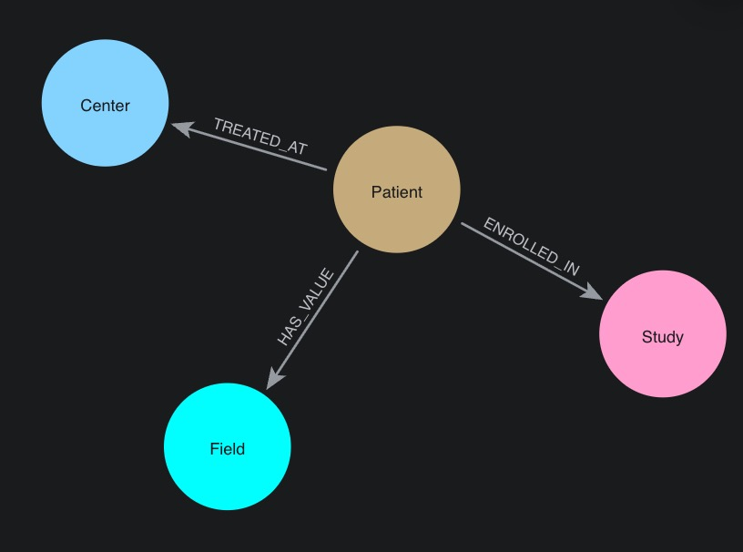

# CIBMTR graph

One Nodestream project loads every extracted public dataset into a single Neo4j graph. Rows are read with [nodestream-plugin-sas](https://github.com/ccloes/nodestream-plugin-sas). Columns are renamed with `data/field_dataset_mapping.csv` and `data/field_ontology.csv`.

Patient identifiers are unique only inside one study. Centers are the same. Do not join those keys across `study_id`.

## Graph



| | |
|---|---|
| `(:Study {study_id})` | One publication dataset |
| `(:Patient {study_id, patient_id})` | One person in that study. `id_source = row` means the file had no patient pseudonym |
| `(:Field {field_id})` | One ontology field, including study-specific fields |
| `(:Center {study_id, center_id})` | Transplant center, when the file has one |
| `(:Patient)-[:ENROLLED_IN]->(:Study)` | |
| `(:Patient)-[:TREATED_AT]->(:Center)` | |
| `(:Patient)-[v:HAS_VALUE {source_variable}]->(:Field)` | `value_num`, `value_text`, `unit` |

Event and competing-risk labels `Yes`, `Event`, `Dead`, `Relapse` become `value_num = 1`. `No`, `Censor…`, and `Alive` become `0`. `Missing` is dropped. A label that is neither is stored raw. Times declared in days are stored in months (`unit = 'months'`). A time with no declared unit is stored as reported and `unit` is blank.

`Field.stack` is `recode`, `crosswalk`, `derive_from_continuous`, or `do_not_stack`. Pool only the first across studies. `do_not_stack` fields are still loaded so a single study can be queried.

## Run

```bash
cd nodestream
make setup          # .venv and .env from .env.example
# set NEO4J_PASSWORD in .env
make install        # Nodestream, the Neo4j plugin, and the SAS plugin (from GitHub)
make validate       # check .env and log in to Neo4j once
make ingest         # migrations, then fields, studies, and patients into Neo4j
```

`make ingest` reads `.env` itself. `nodestream.yaml` requires `NEO4J_URI`, `NEO4J_USERNAME`, and `NEO4J_PASSWORD`. Those names and sample values are in `.env.example`.

`patients.yaml` keeps up to 500 rows from each SAS file (`max_rows`). A file of 500 or fewer rows is kept whole. A larger file is a stable random 500, seeded by the study id, so a rerun keeps the same rows. Forty-three of the 160 studies have a primary file under 500 rows. Three studies also have a second SAS file (`P-5238`, `P-5375`, `P-5924`), and that file is sampled on its own. Remove `max_rows` to load every row. `make pare-down` deletes patients and centers already in Neo4j so the next `make ingest` is that sample. Field and Study nodes stay. From the repo root the same target is `make pare-down`. `make ingest TARGET=dry-run` parses and discards the graph, which checks the project without Neo4j. To try one study, add `study_ids: [P-5051]` under `StudySasExtractor` in `patients.yaml`.

The SAS files are `../data/datasets_extracted`. Questions to ask of the graph are in [queries/questions.md](queries/questions.md).

The graph holds patient-level values. Keep it local; the CIBMTR terms that ship inside each dataset zip still apply.
