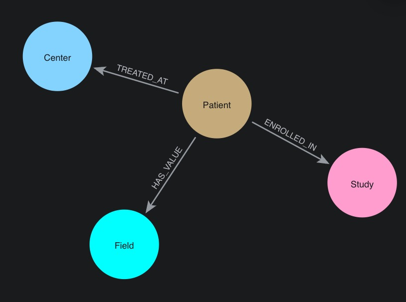

# Questions



Ingest loads all 160 `Study` nodes from `data/catalog.csv` and all 2,535 `Field` nodes from `data/field_ontology.csv`. Patient and center rows follow `max_rows` in `patients.yaml`: up to 500 rows from each SAS file. The first query is who is in Neo4j after the last ingest.

Compare numbers on fields with `stack = 'recode'`. Compare categories by `value_text`. Keep `patient_id` and `center_id` inside one `study_id`. On an event, `value_num` is 1 or 0 when the dictionary label was Dead, Yes, Alive, or No. Times declared in days are stored in months (`unit = 'months'`). A time with no declared unit is stored as reported and `unit` is blank.

Queries that name `P-5051` or `P-5063` are examples. Drop the `study_id` predicate to run the same pattern on every loaded study.

## Who is loaded, and what did each study record?

```cypher
MATCH (p:Patient)-[:ENROLLED_IN]->(s:Study)
RETURN s.study_id, s.title, count(p) AS patients
ORDER BY patients DESC;
```

```cypher
MATCH (p:Patient {study_id: 'P-5063'})-[:HAS_VALUE]->(f:Field)
RETURN f.domain, f.field_id, f.stack, count(p) AS patients
ORDER BY patients DESC;
```

## How many patients died, and how long was follow-up?

```cypher
MATCH (p:Patient)-[v:HAS_VALUE]->(:Field {field_id: 'overall_survival.event'})
WHERE v.value_num IN [0, 1]
RETURN p.study_id,
       sum(CASE WHEN v.value_num = 1 THEN 1 ELSE 0 END) AS deaths,
       count(p) AS known_status;
```

```cypher
MATCH (p:Patient)-[t:HAS_VALUE]->(:Field {field_id: 'overall_survival.time'})
WHERE t.unit = 'months'
RETURN p.study_id,
       percentileCont(t.value_num, 0.5) AS median_months,
       sum(CASE WHEN t.value_num > 12 THEN 1 ELSE 0 END) AS past_one_year,
       count(p) AS patients;
```

## What is the non-relapse mortality rate?

`nrm.event` is the direct flag. Where that column is absent, death with no relapse is the same idea, and the clock is `overall_survival.time`.

```cypher
MATCH (p:Patient)-[v:HAS_VALUE]->(:Field {field_id: 'nrm.event'})
WHERE v.value_num IN [0, 1]
RETURN p.study_id,
       sum(v.value_num) AS nrm,
       count(p) AS known,
       round(100.0 * sum(v.value_num) / count(p), 1) AS pct;
```

```cypher
MATCH (p:Patient)-[dead:HAS_VALUE]->(:Field {field_id: 'overall_survival.event'})
MATCH (p)-[rel:HAS_VALUE]->(:Field {field_id: 'relapse.event'})
MATCH (p)-[t:HAS_VALUE]->(:Field {field_id: 'overall_survival.time'})
WHERE dead.value_num IN [0, 1]
  AND rel.value_num IN [0, 1]
  AND t.unit = 'months'
RETURN p.study_id,
       sum(CASE WHEN dead.value_num = 1 AND rel.value_num = 0 THEN 1 ELSE 0 END) AS death_without_relapse,
       count(p) AS both_known,
       percentileCont(
         CASE WHEN dead.value_num = 1 AND rel.value_num = 0 THEN t.value_num END,
         0.5
       ) AS median_months;
```

## Does death rise with age inside one study?

```cypher
MATCH (p:Patient)-[age:HAS_VALUE]->(:Field {field_id: 'recipient_age.measure'})
MATCH (p)-[dead:HAS_VALUE]->(:Field {field_id: 'overall_survival.event'})
WHERE dead.value_num IN [0, 1]
RETURN p.study_id,
       CASE
         WHEN age.value_num < 40 THEN '<40'
         WHEN age.value_num < 60 THEN '40-59'
         ELSE '60+'
       END AS age_band,
       round(avg(dead.value_num), 3) AS death_rate,
       count(p) AS patients
ORDER BY p.study_id, age_band;
```

## How is sex coded, once labels are used instead of the raw integers?

```cypher
MATCH (p:Patient)-[v:HAS_VALUE]->(:Field {field_id: 'recipient_sex.category'})
RETURN p.study_id, v.value_text AS sex, count(p) AS patients
ORDER BY p.study_id, patients DESC;
```

## Which centers contributed patients in one study?

Center ids are not the same center across studies.

```cypher
MATCH (p:Patient {study_id: 'P-5051'})-[:TREATED_AT]->(c:Center)
RETURN c.center_id, count(p) AS patients
ORDER BY patients DESC
LIMIT 15;
```

## Which outcome fields are safe to pool across studies?

These `recode` fields are the comparable ones. `crosswalk` fields stay as labels.

```cypher
MATCH (f:Field)
WHERE f.stack = 'recode' AND f.domain = 'outcome'
RETURN f.field_id, f.role, f.definition
ORDER BY f.field_id;
```
